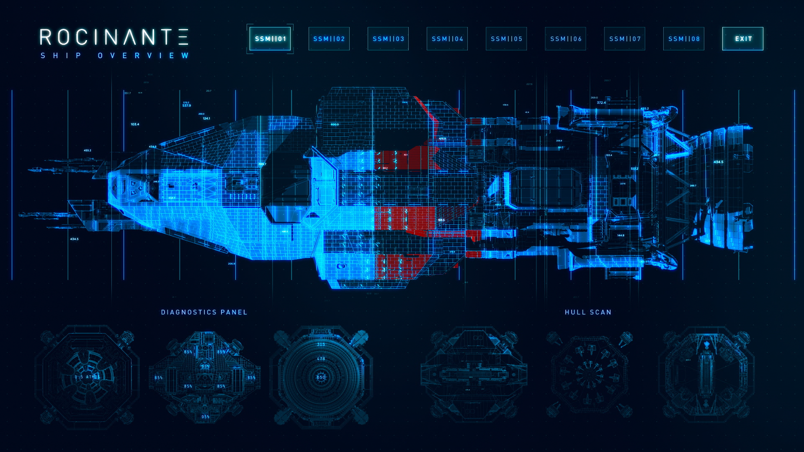
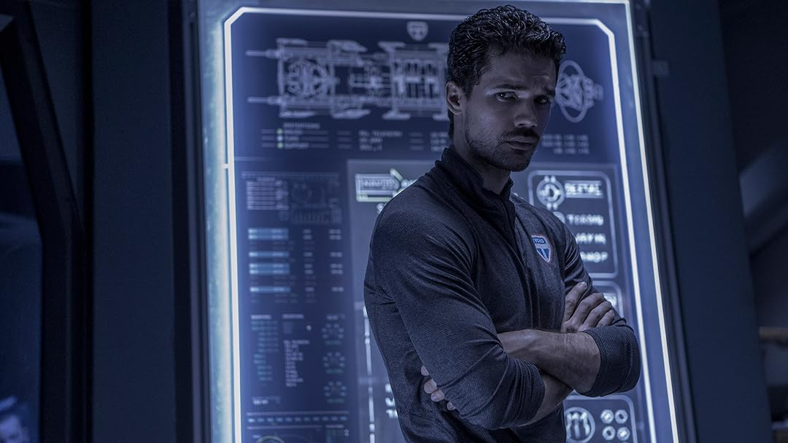

# Ship interface and showcase references

Collected for Lennon's hobby project on 2026-10-19. Keep each ship's evidence
and identity separate. Add original artist pages, TV views and spatial/model
references as research progresses; do not derive every interface from one frame.

The [structured catalogue](ships.json) covers all 23 current ship/scene entries
in the native and Fleet Studio catalogues. It preserves their existing model
and visual-source links with provenance. This is an index, not a claim that all
23 interfaces have been researched or accepted. Imported links are marked as
not reverified during this collection pass.

## Selected Rocinante hull-scan interface

Lennon selected this hull-scan interface as a reference for revisiting the Rocinante's
look and feel. Preserve the latest model; the selection does not approve a
replacement mesh, a finished design, or an immediate change to the app.
Pella's bounded smooth-rotation and resource review was accepted before this
Rocinante study began. Owner correction: these are cockpit hull scans, not
blueprints. Season 6 hull colours require a separate exterior comparison;
the original orange Tachi asset is not a Season 6 colour reference.

- **Work:** Rocinante ship overview / diagnostics / hull scan.
- **UI design and animation:** Harrison Vincent.
- **Project art direction and design:** Ryan Hawthorne.
- **Context:** Amazon Prime Video's San Diego Comic-Con 2019 immersive
  experience. This is event artwork, not an identified TV episode frame.
- **Original project and image:** [Behance image page](https://www.behance.net/gallery/84032987/The-Expanse-Prime-Video-San-Diego-Comic-Con/modules/487155777).
- **Creator's account:** [Harrison Vincent — The Expanse](https://www.harrisonvincent.com/works/the-expanse).
- **Owner selection:** "that roci blueprint we iwll definately use to revisit
  the roci look and feel" — 2026-10-19.
- **Study:** dominant ship silhouette, small schematic annotations, selected
  subsystem emphasis, and diagnostic views around the main ship. Translate
  useful hierarchy into real monitored items; do not add invented telemetry.
- **Archive:** original PNG retained without alteration. SHA-256:
  `b1f2c453d321119da0d9d8800e16f115b639fc01633ff3119c1bc7975ab8b7e0`.
- **Rights:** the Behance page displays Attribution, Non-commercial, No
  Derivatives. These pixels are a study reference, outside the runtime bundle.
  Owner endorsement does not establish permission to modify or redistribute
  them as application artwork.

## New interface and spatial reference leads

| Ship | Source | What is established / remaining |
| --- | --- | --- |
| Rocinante | [Rhys Yorke — Rocinante UI](https://www.artstation.com/artwork/q9Am1L) | Creator description found in search. Direct page returned a sign-in shell; detailed visual review pending. |
| Rocinante | [Chris Danelon — Rocinante Hologram](https://www.youtube.com/watch?v=YWbRAe0N_WA) | Creator's multiple-angle hologram demonstration found in search. Playback and any TV use unverified. |
| Razorback | [Rhys Yorke — Season 5 HUD development](https://rhys.artstation.com/projects/q9VKgD) | Creator describes designing in 3D space to communicate repositioning to VFX. Image and motion comparison pending. |
| Agatha King | [Karl Crosby — Season 3](https://karlcrosby.artstation.com/projects/W2ADZD) | Creator page labels an ops projector and 360 bridge panorama. Detailed visual comparison pending. |

## Per-ship collection

Each entry in `ships.json` contains its own existing model/visual sources,
credits, imported provenance and newly collected interface-reference IDs.
The following links are the existing visual-source starting points, not
newly validated ship-specific UI references.

| Ship / scene | Existing visual-source starting point | Interface selection |
| --- | --- | --- |
| Agatha King | [Lee Fitzgerald / North Front](https://leefitzgerald.artstation.com/projects/X1rzxL) | Karl Crosby projector lead above; further review pending |
| Anubis | [Production concept-art interview](https://magazine.artstation.com/2016/02/scenes-concept-art-expanse/) | Pending |
| Arboghast | [Karl Crosby](https://karlcrosby.artstation.com/projects/1ndxoZ) | Pending |
| Bashi Bazouk | [Existing production-reference link](https://www.artstation.com/artwork/xYGE4O) | Pending |
| Behemoth | [Lee Fitzgerald / North Front](https://leefitzgerald.artstation.com/projects/X1rzxL) | Pending |
| Canterbury | [Ryan Dening](https://deningart.artstation.com/projects/XP8Vl) | Pending |
| Donnager | [Gautam Singh / Spin VFX](https://gautamsingh.artstation.com/projects/ZyEXR) | Pending |
| Dropship | [Existing Mallacore reference](https://rjb-mallacore.artstation.com/projects/d0bQ0w) | Pending |
| Epstein's yacht | [Existing Mallacore reference](https://rjb-mallacore.artstation.com/projects/PenQB4) | Pending |
| Guanshiyin | [Lee Fitzgerald / North Front](https://leefitzgerald.artstation.com/projects/X1rzxL) | Pending; accepted model remains protected |
| Hammurabi | [Ryan Dening — class reference](https://deningart.artstation.com/projects/RyJwRm) | Pending; do not infer its UI from another hull |
| Knight | [Ryan Dening](https://deningart.artstation.com/projects/QaqDE) | Pending |
| Medina | [SYFY concept gallery](https://www.syfy.com/the-expanse/photos/the-expanse-concept-art) | Pending; distinguish station era |
| Morrigan | [Existing Mallacore reference](https://rjb-mallacore.artstation.com/projects/d0bQ0w) | Pending |
| Nauvoo | [SYFY concept gallery](https://www.syfy.com/the-expanse/photos/the-expanse-concept-art) | Pending; distinguish generation-ship era |
| Pella | [Kelvin Tam production asset](https://kelvintam.artstation.com/projects/v2358E) | Active holotable work; research showcase views beyond the previous targeting frame |
| Razorback | [Existing Mallacore reference](https://rjb-mallacore.artstation.com/projects/o2QJBq) | Rhys Yorke spatial HUD lead above |
| Rocinante / Tachi | [Existing visual reference](https://www.artstation.com/artwork/zQwR6) | Owner-selected SDCC blueprint above; revisit later |
| Rocinante Season 6 | [Existing model source](https://www.printables.com/model/136343-rocinante-from-the-expanse) | Shared Roci composition reference; verify era-specific details |
| Scirocco | [Ryan Dening](https://deningart.artstation.com/projects/RyJwRm) | Pending |
| Scopuli | [SYFY concept gallery](https://www.syfy.com/the-expanse/photos/the-expanse-concept-art) | Pending |
| Sol Ring | [Existing gate-reference page](https://expanse.fandom.com/wiki/Sol_gate) | Pending; gate and solar-map marker remain separate |
| Tynan | [Frank Yang / North Front](https://frankyang.artstation.com/projects/3oAAeo) | Pending |

## Shared screen reference with unidentified ship

[Prime Video Season 2 source](https://www.primevideo.com/detail/The-Expanse/0NQ0LAT2BXHNN2871ITVDX6WLX).
Saved and visually inspected. The exact episode, depicted vessel and bridge
are not established here, so this is deliberately unassigned to a ship.
Use it as a lead for schematic presentation, not as Pella or Rocinante UI proof.

The JSON catalogue records original image URLs, sizes and SHA-256 hashes.
These files are documentation/research material; neither app loads this folder.
